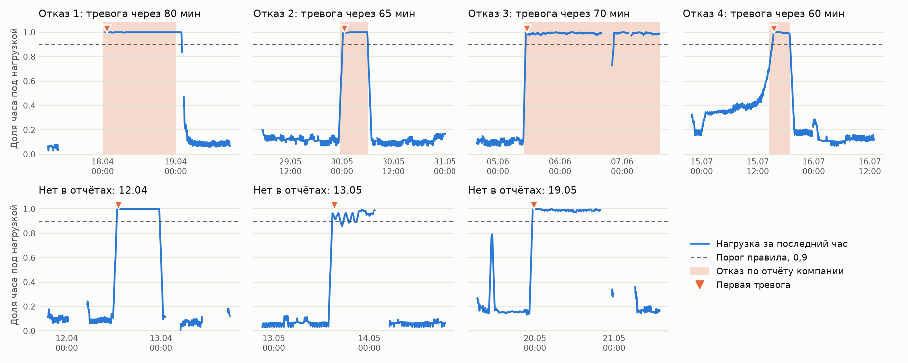

# Раннее обнаружение отказов оборудования по телеметрии

Проверка подходов на реальных данных компрессора поезда метро: датасет [MetroPT-3](https://archive.ics.uci.edu/dataset/791/metropt+3+dataset), 7 месяцев 2020 года, 1,5 млн замеров, 4 отказа из отчётов компании (утечка воздуха).

**Главный вывод:** простое инженерное правило обнаружило все 4 отказа примерно за час с 3 лишними эпизодами за 5 месяцев. Ни один вариант статистических и ML-моделей не дал такого сочетания. **Заранее предсказать отказы не удалось:** первая тревога приходит уже после начала отказа. Это система раннего обнаружения, а не прогноз.



## Результаты

Проверка на апреле–августе. Каждый месяц модели обучаются только на прошлых данных. Тревога требует, чтобы оценка держалась выше порога 30 минут подряд.

| Подход | Поймано отказов | Задержка от начала отказа, мин (№1, №2, №3, №4) | Лишних эпизодов за 5 месяцев |
|---|---|---|---|
| **Правило: под нагрузкой более 90% часа** | **4 из 4** | 80, 65, 70, 60 | **3** |
| Статистика: robust z | 3 из 4 | 770, 325, 365, нет | 4 |
| Isolation Forest | 3 из 4 | нет, 50, 265, 55 | 5 |
| Логистическая регрессия | 2 из 3 возможных | не обучена, 35, 60, нет | 10 |
| Штатный сигнал низкого давления (LPS) | см. ниже | см. ниже | 58 |

Для трёх моделей порог взят как 99,5-й перцентиль оценок на здоровых барах обучения. Ближе всего к правилу Isolation Forest с порогом 99%: он тоже ловит все 4 отказа и на трёх из них реагирует быстрее (45, 65 и 40 минут), но отказ №1 находит только через 1055 минут и даёт 6 лишних эпизодов. Все варианты порогов есть в [reports/metrics.json](reports/metrics.json).

Логистическая регрессия не участвует в проверке отказа №1: до него не на чем учиться.

Штатный сигнал LPS часто срабатывает и без отказов, поэтому совпадения с окнами отказов нельзя считать предупреждением. Его тревоги за сотни минут до отказов №1 и №4, скорее всего, случайны: такие импульсы идут в среднем чаще раза в три дня.

## Что нашлось в данных

- **Залипшие датчики: 170 часов.** Показания идеально постоянны, а без фильтра правило приняло бы за отказ залипание 22–25 июня. С фильтром эта ложная тревога исчезает.
- **Нет данных: 898 часов из 5116, около 18%.** В такие периоды система не выдаёт оценку и не притворяется, что всё нормально.
- **Три эпизода, похожих на отказ, которых нет в отчётах:** 12 апреля, 13 мая и 19–20 мая. Компрессор работает под нагрузкой без остановки около 10–20 часов. В таблице они считаются лишними тревогами, но могут быть и незарегистрированными проблемами. Проверить это по открытым данным нельзя.
- **Предвестник заметен только у одного отказа из четырёх.** Перед №4 нагрузка растёт примерно 14 часов. Перед №2 и №3 она подскакивает резко, а перед №1 около 15 часов датчики были залипшими, так что судить нельзя. По одному случаю нельзя строить правило раннего предупреждения.
- **Неточности в описании датасета.** В описании указана запись 1 Гц и 15,2 млн точек, а в файле шаг около 10 секунд и 1,5 млн. Второй отказ подписан как #1, а его обслуживание датировано раньше самого отказа.

## Ограничения

- **Отказов всего 4, компрессор один.** Это демонстрация подхода, а не статистически надёжная оценка. Переносить цифры на другое оборудование нельзя.
- **Нет полностью независимой проверки.** Признаки и порог правила выбраны после просмотра тех же данных, на которых идёт проверка, поэтому результат правила может быть завышен.
- **Правило узкое.** Оно ловит утечку воздуха, при которой компрессор работает без остановки. Другие типы отказов оно не увидит, а на другом оборудовании его придётся настраивать заново.
- **Экономический эффект не считался.** Стоимости простоя и лишнего осмотра в данных нет.

## Как устроен код

| Файл | Что делает |
|---|---|
| `src/pdm/data.py` | Загрузка, проверка данных, таблица отказов |
| `src/pdm/features.py` | 5-минутные бары, контроль качества, признаки только по прошлому |
| `src/pdm/models.py` | Правила и модели с единым интерфейсом |
| `src/pdm/evaluation.py` | Оценка по событиям, проверка с движением вперёд по времени |
| `tests/` | Тесты: нет подсмотра будущего, верный подсчёт событий, отбраковка плохих данных |
| `legacy/` | Первая версия проекта на синтетических данных |

## Запуск

Скачайте архив с [страницы датасета](https://archive.ics.uci.edu/dataset/791/metropt+3+dataset), распакуйте CSV, затем:

```bash
python -m venv .venv
.venv/Scripts/python -m pip install -e ".[dev]"
.venv/Scripts/python -m pytest
.venv/Scripts/python scripts/run_metropt3.py "путь/к/MetroPT3(AirCompressor).csv"
.venv/Scripts/python scripts/plot_metropt3.py "путь/к/MetroPT3(AirCompressor).csv"
```

На Linux и macOS вместо `.venv/Scripts/python` используйте `.venv/bin/python`.

## История проекта

1. **Первая версия: учебный прототип на синтетических данных.** Отказ в ней задан правилом по тем же показаниям, которые получает модель, поэтому высокие метрики ничего не говорили о предсказании реальных отказов. Код лежит в [legacy/](legacy/), а весь репозиторий в том виде можно открыть по метке [v1-synthetic](https://github.com/v94e92-prog/industrial-predictive-maintenance/tree/v1-synthetic).
2. **Текущая версия: реальные данные MetroPT-3.** Тестируемый пакет, проверка по времени, оценка по событиям и контроль качества данных.

## Источник данных

Veloso B., Ribeiro R.P., Pereira P.M., Gama J. The MetroPT dataset for predictive maintenance. *Scientific Data* 9, 764 (2022). DOI: 10.1038/s41597-022-01877-3. Сами данные в репозиторий не входят.
